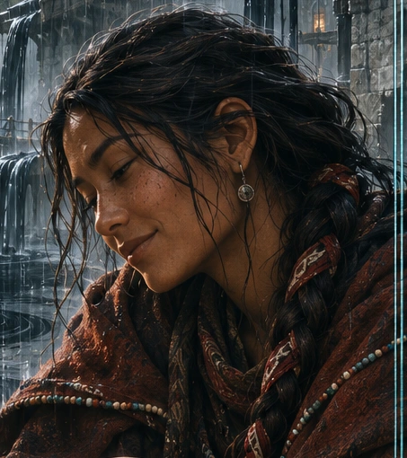

## En une phrase
Jeune Passebrume, amoureuse d'Eleanore, qui poursuit son rêve après sa disparition.

## Apparence

Ilwë a le teint brun et les cheveux noirs. Elle noue sa longue tresse avec un ruban et porte un manteau brun rouge bordé de perles.

## Caractère et motivations
_À compléter._

## Histoire
- Membre des [Passebrume](../factions/passebrume.md), peuple sans écriture.
- Dans Vivencre, elle rencontre [Eleanore](eleanore.md) : leur amour naissant est l'un des sujets
  du roman.
- Dans Vivebrume, après qu'Eleanore s'est abandonnée à la vivebrume, elle poursuit avec
  [Semekhet](semekhet.md) le rêve d'Eleanore d'une nation unie et égale.

## Relations
- [[eleanore]] : sa petite amie.
- [[semekhet]] : compagnon dans la fondation de la nation (Vivebrume).

## Apparitions
- Vivencre, Vivebrume.
