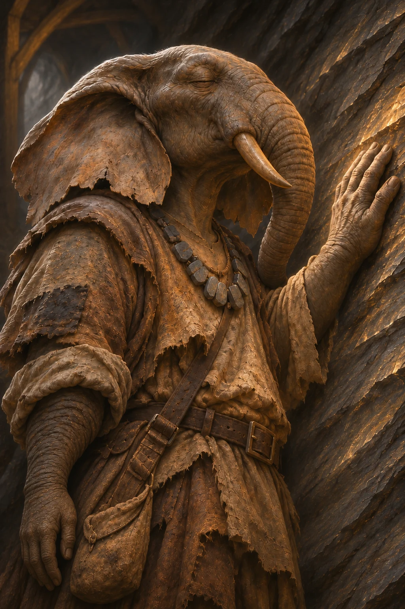

## En une phrase
Oliphant aveugle, esclave des mines, qui voit à travers la vivepierre.

## Apparence

- **Oliphant** (éléphant anthropomorphe), peau brune et ridée, grandes oreilles déchiquetées.
- **Yeux clos** (il est aveugle de naissance) ; une défense visible, trompe recourbée.
- Mains à cinq doigts ; il « voit » en posant la paume sur la paroi de vivepierre.
- Tunique en haillons rapiécée, ceinture et bandoulière de cuir, besace à la hanche.
- Au cou, son **collier de perles de vivardoise** : des pierres sombres, taillées en gros blocs.

## Caractère et motivations
_À compléter._

## Histoire
- [Vivardoise](../factions/vivardoises.md) : esclave des
  [mines de Vivepierre](../lieux/mines-de-vivepierre.md).
- **Aveugle de naissance**, il voit grâce à la vivepierre, qui absorbe les visions alentour : sa vue est
  **déformée et décalée dans le temps**.
- Dans les galeries anciennes, la pierre lui montre des esclaves morts depuis longtemps : c'est ce
  qui déclenche son évasion.
- Il s'évade avec un groupe de vivardoises, poursuivi par des chasseurs de primes et des soldats
  d'Eitrom. Sa fuite finit en cul-de-sac devant la
  [vivebrume](../lieux/zone-de-vivebrume.md).
- Il porte un **collier de perles de vivardoise** qu'il a construit lui-même dans les mines.
- Dans Vivebrume, Eleanore devenue brume s'enferme dans son collier ; plus tard, il **devient une
  statue de vivepierre**. Il fusionne ainsi concrètement avec [Eleanore](eleanore.md) en une
  relique mythique qui fonde la nation utopique. Avec [Ilwë](ilwe.md), la petite amie d'Eleanore, il
  poursuit le rêve d'Eleanore d'une nation unie et égale.
- Dans Vivebraise, leur conscience, toujours dans la relique, ouvre le roman en pleine
  désillusion devant la dystopie qu'est devenu leur rêve.
- À la fin de Vivebraise, [Wanjil](wanjil.md) les libère de la relique dans un feu de joie.

## Relations
- [[eleanore]] : fusionne avec elle dans la relique (Vivebrume).
- [[eitrom]] : ses anciens maîtres, qu'il fuit (Vivepierre).

## Apparitions
- Vivepierre : personnage principal.
